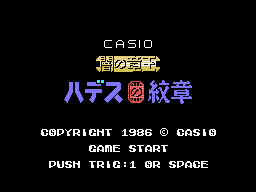
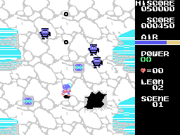
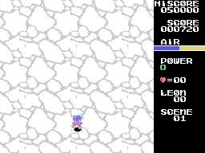

# The game

*The Seal of Hades* (闇の竜王 ハデスの紋章, Yami no Ryuuou Hadesu no Monshou, "the dragon king of darkness: the seal
of Hades") is a shoot-'em-up on foot, going up. Leon walks through six scenes of eleven screens each, shooting
upwards; at the end of each scene a guardian is waiting. The scenes, in [The scenes](THE-SCENES.html).

Every GIF on this site is the ROM **running in openMSX** (a Japanese MSX1 with C-BIOS, at 60 frames per second): on
every frame the VRAM, the RAM and the VDP registers are logged, and `tools/vdp.py` paints them. The game ones are
played by a pilot written for the purpose (`tools/guiones/piloto.tcl`): it shoots non-stop, goes up nearly all the
time and steps aside.

## The intro and the title

Two CASIO come in from the sides and two more go down and up until they meet, with SOFTWARE underneath
(`presentacion`, 0x8C42). The title puts up the name (闇の竜王 and ハデスの紋章, 0x8D8E), CASIO, the copyright, GAME
START and PUSH TRIG:1 OR SPACE, and plays its tune, almost a minute long (number 8). If it ends with nothing pressed,
the **demo** starts: a random scene out of the first four, with the controls read from a list that starts at
0x4000... the cartridge header (see [Curiosities](CURIOSITIES.html)).

## The controls

| | joystick | keyboard |
|---|---|---|
| walk | joystick 1 | the cursors |
| shoot | button 1 | the space bar |
| pause | | STOP |
| give up | | F1 |

Above the middle of the screen (Y 0x78), going up makes the screen **move on**: one row of tiles every 16 frames
(`avanza`, 0x9D82). Each scene is eleven screens of 24 rows; in the last two it no longer moves and the guardian
pushes Leon down.

## AIR and POWER

**AIR** (the blue bar) goes down one eighth every 240 frames (`air_tiempo`, 0x88C2); empty, Leon falls. Each scene
starts with 16 eighths more (up to 48), and some things in the blocks add 2. **POWER** (the green bar) decides how
many shots at once (one; two with 16; three with 24; four with 32) and the weapon: with 40, 48 and 56 eighths,
weapons 1, 2 and 3 (`power_barra`, 0x87BD): with 2 and 3 the shot is wider, and those of 1 and 3 go through the first
target (`disparo_da`, 0xA848). On falling, Leon loses the weapon and 8 of POWER.

## The ground blocks

The raised tiles are **blocks** the shots break (six hits; with weapon 2 or more, two at a time). Inside there is, at
random, nothing (50 points) or a thing: POWER +2, AIR +2 or one of two powers that last about 13 seconds and make Leon
blink: with one the enemies do nothing to him; with the other he beats them by touching them (`prota_coge`, 0x9840).
Other blocks always keep the same: POWER +8, or a **heart** (♥ on the scoreboard) with one more weapon; with hearts,
certain bullets take one instead of the life. A special block is the scene's **exit**.

## LEON and the points

LEON are the spare lives: two at the start (three falls to GAME OVER) and one more at 30,000 points. The score has a
fixed 0 after it: what the game adds, times 10 on screen. The high score starts at 50,000.

The game the pilot plays: the first scene, the moving screen, the bullets and three falls to GAME OVER.

