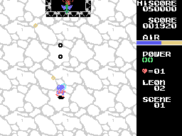
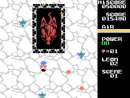
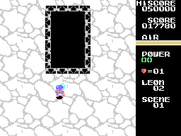
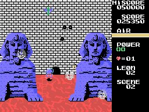
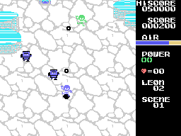
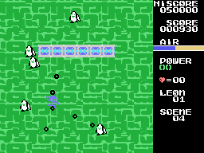
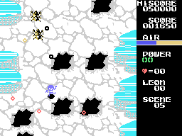
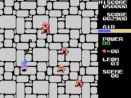

# The scenes

Six scenes (SCENE 1-6 on the scoreboard; 0xE003 from 0 to 5), each of **eleven screens** of 24 x 24 tiles (the table
at 0x4068: one pointer per scene and eleven per screen). Each screen is built in RAM (0xEA80) from its description
-rectangles, fills, the side border, drawings and objects- and comes in from the top row by row as Leon moves on
(`pantalla_monta`, 0x9B89). Scene 6 repeats almost every screen of scene 2.

## What is on the ground

| object | what it is |
|---|---|
| 0, 1 and 3 | blocks broken by shooting; inside, nothing or a random thing (3, POWER + 8) |
| 2 | a block with a heart and one more weapon |
| 4 | a hole: if Leon falls in, he dies (23 in scene 3 and 32 in scene 5) |
| 5 | the exit: broken, touched, and the scene is over (500 points; in scene 6, on breaking it, 1,000) |
| 6 | a piece of the guardian |
| 7 and 9 | cannons that put out enemies every so often |
| 8 | a mouth that opens and shuts and puts out enemies |
| 10 | lets out a thing that comes down (enemy 0x0A): touching it gives speed and, with two, one more weapon |

## The enemies

They come out on their own every so often (`enemigos_salen`, 0xAC50: more often the higher the scene), of the type
the table at 0xACB6 gives for each scene and screen, and also from the cannons and the mouths. They come down
diagonally, zigzagging or swaying; some shoot bullets that go where Leon was, and so do the turrets on the ground. One
shot beats them (50 to 200 points); types 4, 7 and 9 take four with weapons 0 and 1.

## The end of each scene

On the last two screens the scene no longer moves and waits for its end:

| scene | the end |
|---|---|
| 1 | the guardian: one piece |
| 2 | two cannons and the exit |
| 3 | the guardian: two pieces |
| 4 | two mouths: with both broken, it is over |
| 5 | the guardian: three pieces |
| 6 | five cannons per screen and the exit, which ends the game |

**The guardian** is a frame with the dragon king (object 6): it shoots, changes drawing every 64 frames and takes 20
shots per piece (2,000 points each); with all broken, the screen flashes and the scene is over (`guardian`, 0xAA7E).
With the scene over its tune plays, Leon gets air back and the next one starts.

The GIFs of the guardian and of scenes 2 and 3 are a game with TAB and CAPS held in the intro (Leon does not die and
LEON never runs out, see [Curiosities](CURIOSITIES.html)) and the pilot, which gets to scene 3 on its own.

Scenes 4, 5 and 6 are **forced**: the scene put by hand (0xE003) and F1, so that Leon falls and the scene starts
again, now the new one, at the screen he was on.

## The ending

With scene 6 over, tune 7, four sprites that come down -the goddess- and her text: "わたしは ほしのめがみ エーメ"
(I am Eme, the goddess of the stars), the dragon king is gone and she gives Leon the title of light イルシオン; some
day his courage will be tested again (see [The texts](THE-TEXTS.html)). Tune 7 plays over and over until the button,
which goes back to the title (`final`, 0x846C). The GIF is **forced**: scene 6 marked as over (0xE184 = 1).

