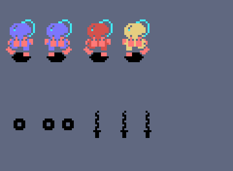
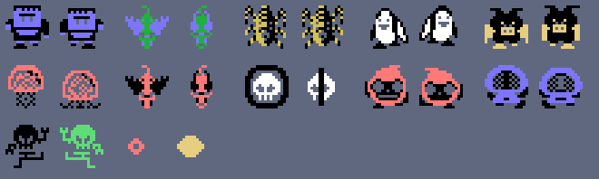
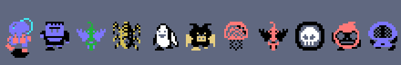

# The sprites

Everything on this page is **put together from the ROM tables** with `tools/hojas.py`: the drawings are the 0x800
bytes at 0x9000 that `sprites_dibujos` puts as they are at 0x3800, and every figure is built with the drawings,
colours and places its own routine gives it. Each thing is made of 16-byte sprites from 0xE300 (the first 4, its
attributes). None of these images is a screenshot.

**Checked against openMSX** on the recordings of this site:

- the sprite drawing table (VRAM 0x3800-0x3FFF) is **identical** to the game's on 48,832 frames (4 more catch the
  copy halfway);
- the hero's four sprites (0xE300-0xE330) match in place, drawing and colour on 41,128 frames (90 more are still at
  zero); **57 unexplained**;
- the enemies have the drawings and colours of their type, with their second sprite in the same place, on 90,076
  frames; 528 more have just come out (still with drawing 0x30), 15,426 are blowing up and 15,786 are empty slots
  or pieces 0xF0-0xFC; **12 unexplained**.

## The hero

Four sprites (`prota_sprites` 0x9801, `prota_dibujos` 0x982D): A at 0xE320 in light blue (with a power, dark red or
light yellow), A + 4 at 0xE330 9 dots above it in cyan, A + 8 at 0xE300 7 dots below in light red and A + 12 at
0xE310 14 dots below in black. A is 0 or 0x10: every 16 frames standing still and every 8 walking (`prota_quieto`,
0x9820). Below, his shot (`disparo`): the drawing of his weapon, 0x20, 0x24, 0x28 or 0x2C, in black:

The listing said that A + 8 went to 0xE310 and A + 12 to 0xE300; the code (IX - 0x1E and IX - 0x0E) does it the
other way round, and now the listing says so.

## The enemies

Two sprites in the same place, the drawing and the drawing + 4 (the second is the next slot, with type 15); every 8
frames the drawing + 8. Type 1 (and 2 and 8 as they come out: 0x30), 0 and 8 (0xB8), 2 (0xC8) and 6 (0x70) of
`enemigo_a`; 3 (0x40), 4 (0xD8) and 5 (0xB8) of `enemigo_b`; 7 (0x60, `enemigo_c`), 9 (0x50, `enemigo_d`) and 10
(0x80). Below, beaten (`vencido`, 0x9F2D): the big explosion of types 1, 3 and 6 (0xA8 and 0xAC every 8 frames,
black and light green every 2) and the small one of the others (0xB0 and 0xB4, light red and light yellow):

The hero and the enemies with their two drawings, at the game's pace:

