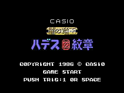
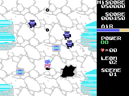
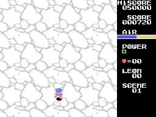

# La partida

*The Seal of Hades* (闇の竜王 ハデスの紋章, Yami no Ryuuou Hadesu no Monshou, "el rey drag&oacute;n de las
tinieblas: el sello de Hades") es un matamarcianos a pie y hacia arriba. Leon avanza por seis escenas de once
pantallas cada una, disparando hacia arriba; al final de cada escena espera un guardi&aacute;n. Las escenas, en [Las
escenas](LAS-ESCENAS.html).

Cada GIF de esta web es la ROM **funcionando en openMSX** (un MSX1 japon&eacute;s con C-BIOS, a 60 cuadros por
segundo): en cada cuadro se apuntan la VRAM, la RAM y los registros del VDP, y `tools/vdp.py` los pinta. Los de la
partida los juega un piloto escrito para la ocasi&oacute;n (`tools/guiones/piloto.tcl`): dispara sin parar, sube casi
siempre y se aparta a los lados.

## La presentaci&oacute;n y el t&iacute;tulo

Dos CASIO entran por los lados y otros dos bajan y suben hasta juntarse, con SOFTWARE debajo (`presentacion`,
0x8C42). El t&iacute;tulo pone el nombre (闇の竜王 y ハデスの紋章, 0x8D8E), CASIO, el copyright, GAME START y PUSH
TRIG:1 OR SPACE, y toca su m&uacute;sica, de casi un minuto (la 8). Si acaba sin pulsar nada, empieza la
**demostraci&oacute;n**: una escena al azar de las cuatro primeras, con los mandos le&iacute;dos de una lista que
empieza en 0x4000... la cabecera del cartucho (ver [Curiosidades](CURIOSIDADES.html)).

## Los mandos

| | mando | teclado |
|---|---|---|
| andar | mando 1 | los cursores |
| disparar | bot&oacute;n 1 | la barra |
| pausa | | STOP |
| rendirse | | F1 |

Por encima de la mitad de la pantalla (la Y 0x78), subir hace **avanzar** la pantalla: una fila de casillas cada 16
cuadros (`avanza`, 0x9D82). Cada escena son once pantallas de 24 filas; en las dos &uacute;ltimas ya no avanza y el
guardi&aacute;n empuja a Leon hacia abajo.

## AIR y POWER

**AIR** (la barra azul) baja un octavo cada 240 cuadros (`air_tiempo`, 0x88C2); vac&iacute;a, Leon cae. Cada escena
empieza con 16 octavos m&aacute;s (hasta 48), y algunas cosas de los bloques suben 2. **POWER** (la barra verde)
decide cu&aacute;ntos disparos a la vez (uno; dos con 16; tres con 24; cuatro con 32) y el arma: con 40, 48 y 56
octavos, las armas 1, 2 y 3 (`power_barra`, 0x87BD): con la 2 y la 3 el disparo es m&aacute;s ancho, y los de la
1 y la 3 atraviesan el primer blanco (`disparo_da`, 0xA848). Al caer, Leon pierde el arma y 8 de
POWER.

## Los bloques del suelo

Las baldosas con relieve son **bloques** que los disparos rompen (seis golpes; con el arma 2 o m&aacute;s, de dos en
dos). Dentro hay, al azar, nada (50 puntos) o una cosa: POWER +2, AIR +2 o uno de dos poderes que duran unos 13 segundos
y hacen parpadear a Leon: con uno los enemigos no le hacen nada; con el otro los vence al tocarlos (`prota_coge`,
0x9840). Otros bloques guardan siempre lo mismo: POWER +8, o un **coraz&oacute;n** (♥ en el marcador) con un arma
m&aacute;s; con corazones, ciertas balas se llevan uno en vez de la vida. Un bloque especial es **la salida** de la
escena.

## LEON y los puntos

LEON son las vidas de reserva: dos al empezar (tres ca&iacute;das hasta GAME OVER) y una m&aacute;s a los 30.000 puntos. Los puntos llevan un 0 fijo detr&aacute;s:
lo que suma el juego, por 10 en pantalla. El r&eacute;cord empieza en 50.000.

La partida que juega el piloto: la primera escena, la pantalla que avanza, las balas y tres ca&iacute;das hasta GAME
OVER.

