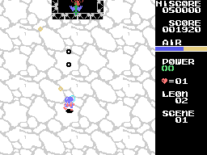
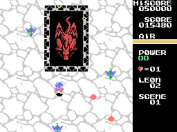
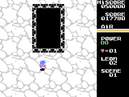
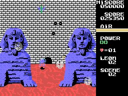
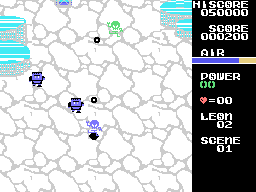
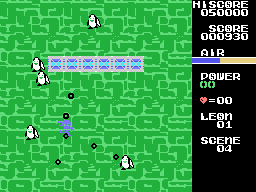
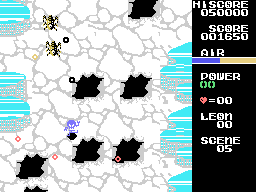
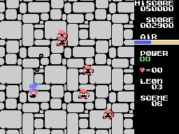

# Las escenas

Seis escenas (SCENE 1-6 en el marcador; 0xE003 de 0 a 5), cada una de **once pantallas** de 24 x 24 casillas (la
tabla de 0x4068: un puntero por escena y once por pantalla). Cada pantalla se monta en la RAM (0xEA80) desde su
descripci&oacute;n -rect&aacute;ngulos, rellenos, el borde de los lados, dibujos y objetos- y entra por arriba fila a
fila mientras Leon avanza (`pantalla_monta`, 0x9B89). La escena 6 repite casi todas las pantallas de la 2.

## Lo que hay en el suelo

| objeto | qu&eacute; es |
|---|---|
| 0, 1 y 3 | bloques que se rompen a disparos; dentro, nada o una cosa al azar (el 3, POWER + 8) |
| 2 | un bloque con un coraz&oacute;n y un arma m&aacute;s |
| 4 | un agujero: si Leon cae dentro, muere (hay 23 en la escena 3 y 32 en la 5) |
| 5 | la salida: rota, se toca y la escena se acaba (500 puntos; en la escena 6, al romperla, 1.000) |
| 6 | una pieza del guardi&aacute;n |
| 7 y 9 | ca&ntilde;ones que sacan enemigos cada poco |
| 8 | una boca que se abre y se cierra y saca enemigos |
| 10 | suelta una cosa que baja (el enemigo 0x0A): tocarla da velocidad y, con dos, un arma m&aacute;s |

## Los enemigos

Salen solos cada poco (`enemigos_salen`, 0xAC50: m&aacute;s a menudo cuanto m&aacute;s alta la escena), del tipo que
dice la tabla de 0xACB6 para cada escena y pantalla, y tambi&eacute;n de los ca&ntilde;ones y las bocas. Bajan en
diagonal, en zigzag o meci&eacute;ndose; unos disparan balas que van hacia donde estaba
&eacute;l, y las torretas del suelo tambi&eacute;n. Un disparo los vence (de 50 a 200 puntos); los de tipo 4, 7 y 9
aguantan cuatro con las armas 0 y 1.

## El final de cada escena

En las dos &uacute;ltimas pantallas la escena ya no avanza y espera su final:

| escena | el final |
|---|---|
| 1 | el guardi&aacute;n: una pieza |
| 2 | dos ca&ntilde;ones y la salida |
| 3 | el guardi&aacute;n: dos piezas |
| 4 | dos bocas: rotas las dos, se acaba |
| 5 | el guardi&aacute;n: tres piezas |
| 6 | cinco ca&ntilde;ones por pantalla y la salida, que acaba la partida |

**El guardi&aacute;n** es un cuadro con el rey drag&oacute;n (el objeto 6): dispara, cambia de dibujo cada 64
cuadros y aguanta 20 disparos por pieza (2.000 puntos cada una); rotas todas, la pantalla parpadea y la escena se
acaba (`guardian`, 0xAA7E). Con la escena acabada suena su m&uacute;sica, Leon recupera aire y empieza la siguiente.

Los GIF del guardi&aacute;n y de las escenas 2 y 3 son una partida con TAB y CAPS pulsadas en la presentaci&oacute;n
(Leon no muere y LEON no se acaba, ver [Curiosidades](CURIOSIDADES.html)) y el piloto, que llega solo hasta la escena
3.

Las escenas 4, 5 y 6 son **forzadas**: la escena puesta a mano (0xE003) y F1, con lo que Leon cae y la escena
empieza otra vez, ya la nueva, en la pantalla en que estaba.

## El final

Acabada la escena 6, la m&uacute;sica 7, cuatro sprites que bajan -la diosa- y su
texto: "わたしは ほしのめがみ エーメ" (soy Eme, la diosa de las estrellas), el rey drag&oacute;n se ha ido y a Leon le da
el t&iacute;tulo de luz イルシオン; alg&uacute;n d&iacute;a su valor volver&aacute; a ponerse a prueba (ver [Los
textos](LOS-TEXTOS.html)). La m&uacute;sica 7 suena una y otra vez hasta el bot&oacute;n, que vuelve al t&iacute;tulo
(`final`, 0x846C). El GIF es **forzado**: la escena 6 dada por acabada (0xE184 = 1).

