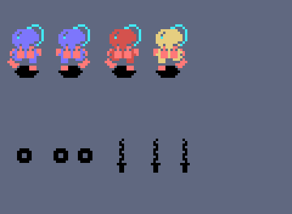
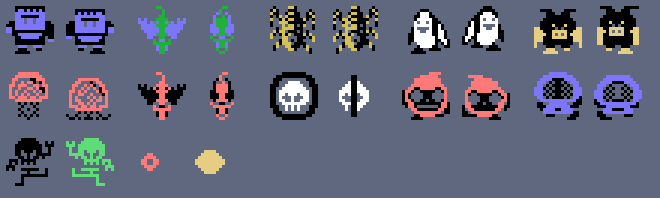
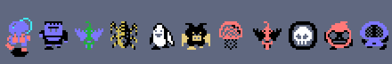

# Los sprites

Todo lo de esta página está **montado desde las tablas de la ROM** con `tools/hojas.py`: los dibujos son los 0x800
bytes de 0x9000 que `sprites_dibujos` pone tal cual en 0x3800, y cada figura se arma con los dibujos, los colores y
los sitios que le da su propia rutina. Cada cosa son sprites de 16 bytes desde 0xE300 (los 4 primeros, sus
atributos). Ninguna de estas imágenes es una captura.

**Cotejado con openMSX** en las grabaciones de esta web:

- la tabla de dibujos de los sprites (VRAM 0x3800-0x3FFF) es **idéntica** a la del juego en 48.832 cuadros (otros 4
  pillan la copia a medias);
- los cuatro sprites del protagonista (0xE300-0xE330) casan en sitio, dibujo y color en 41.128 cuadros (otros 90 aún
  están a cero); **57 sin explicar**;
- los enemigos llevan los dibujos y colores de su tipo, con su segundo sprite en el mismo sitio, en 90.076 cuadros;
  otros 528 acaban de salir (aún con el dibujo 0x30), 15.426 están estallando y 15.786 son huecos vacíos o piezas
  0xF0-0xFC; **12 sin explicar**.

## El protagonista

Cuatro sprites (`prota_sprites` 0x9801, `prota_dibujos` 0x982D): A en 0xE320 en azul claro (con un poder, rojo
oscuro o amarillo claro), A + 4 en 0xE330 9 puntos por encima en cian, A + 8 en 0xE300 7 por debajo en rojo claro y
A + 12 en 0xE310 14 por debajo en negro. A es 0 o 0x10: cada 16 cuadros quieto y cada 8 andando (`prota_quieto`,
0x9820). Abajo, su disparo (`disparo`): el dibujo de su arma, 0x20, 0x24, 0x28 o 0x2C, en negro:

El listado decía que A + 8 iba a 0xE310 y A + 12 a 0xE300; el código (IX - 0x1E e IX - 0x0E) lo hace al revés, y
ahora el listado lo dice así.

## Los enemigos

Dos sprites en el mismo sitio, el dibujo y el dibujo + 4 (el segundo es el hueco siguiente, con el tipo 15); cada 8
cuadros, el dibujo + 8. El tipo 1 (y el 2 y el 8 al salir: 0x30), el 0 y el 8 (0xB8), el 2 (0xC8) y el 6 (0x70) de
`enemigo_a`; el 3 (0x40), el 4 (0xD8) y el 5 (0xB8) de `enemigo_b`; el 7 (0x60, `enemigo_c`), el 9 (0x50,
`enemigo_d`) y el 10 (0x80). Abajo, vencidos (`vencido`, 0x9F2D): la explosión grande de los tipos 1, 3 y 6 (0xA8 y
0xAC cada 8 cuadros, negro y verde claro cada 2) y la chica de los demás (0xB0 y 0xB4, rojo claro y amarillo claro):

El protagonista y los enemigos con sus dos dibujos, al ritmo del juego:

